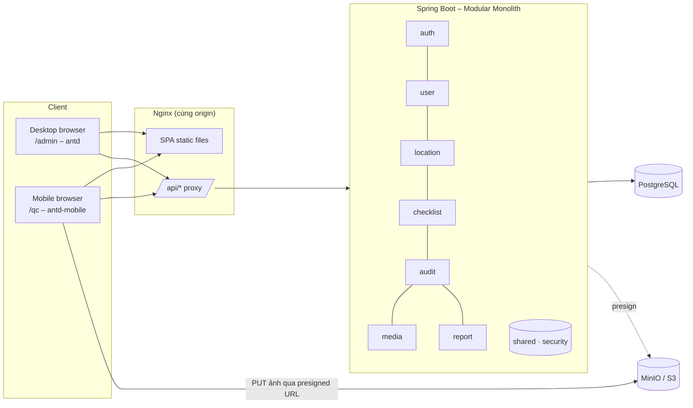
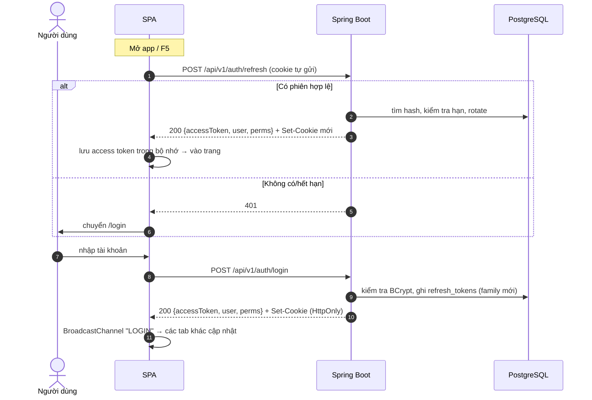
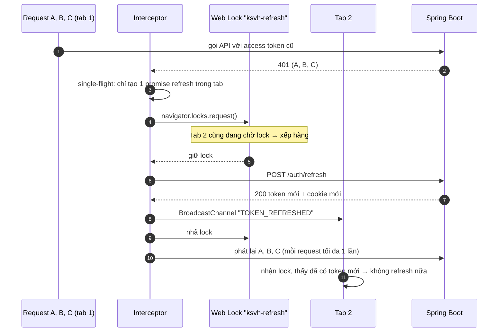
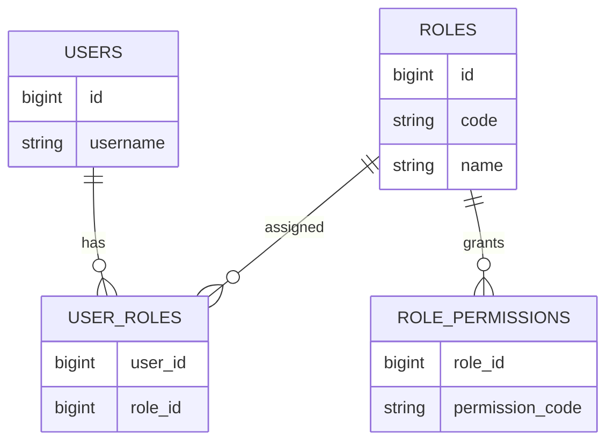
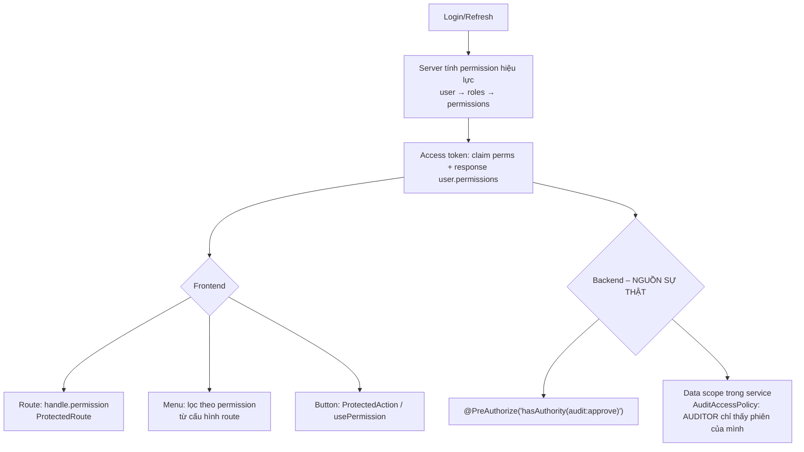
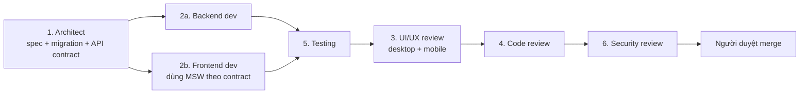

# Đề xuất kiến trúc – KSVH QC (Phase 1: Architecture)

> Trạng thái: **CHỜ DUYỆT**. Tài liệu này chỉ phân tích và đề xuất; chưa thay đổi source code.
> Ngày: 09/11/2026. Phạm vi: `backend/` (Spring Boot) và `frontend/` (React).

Mục lục: [1. Phân tích hiện trạng](#1-báo-cáo-phân-tích-dự-án-hiện-tại) · [2. Kiến trúc tổng thể](#2-kiến-trúc-tổng-thể) · [3. Tech stack](#3-tech-stack-và-lý-do) · [4–5. Cấu trúc thư mục](#4-cấu-trúc-thư-mục-chi-tiết) · [6. Authentication](#6-authentication--jwt--session) · [7. Permission](#7-permission--rbac) · [8. API layer](#8-kiến-trúc-api-layer) · [9. Component dùng chung](#9-component-dùng-chung) · [10. Thư viện](#10-thư-viện-cần-cài) · [11. AI agents](#11-ai-agents--workflow) · [12. Kế hoạch](#12-kế-hoạch-triển-khai) · [13. Cần bạn quyết định](#13-các-quyết-định-cần-duyệt)

---

## 1. Báo cáo phân tích dự án hiện tại

### 1.1 Công nghệ & phiên bản (đo trực tiếp từ source)

| Tầng | Thành phần | Phiên bản |
|---|---|---|
| Backend | Java / Spring Boot / Spring Security | 21 / 4.1.2 / 7.1.2 |
| | Hibernate / Flyway / PostgreSQL | 7.4.13 / 12.4.0 / 17.11 (Homebrew) |
| | springdoc-openapi / AWS SDK S3 / Tomcat | 3.2.0 / 2.57.11 / 11.0.27 |
| | Jackson | **3.1.7 và 2.21.7 cùng tồn tại** (springdoc, AWS SDK kéo Jackson 2) |
| Frontend | React / TypeScript / Vite | 19.3.1 / 7.0.2 / 8.3.6 |
| | React Router / TanStack Query / Zustand | 8.5.1 / 5.107.1 / 5.1.0 |
| | antd / antd-mobile | 6.7.0 / 5.43.0 |
| | Axios / react-hook-form / zod | 1.21.0 / 7.91.0 / 4.6.7 |
| | Lint | oxlint 1.92 (chưa có Prettier) |

### 1.2 Quy mô hiện tại
- Backend: 29 file, ~740 dòng. File lớn nhất `SecurityConfig.java` 84 dòng.
- Frontend: 19 file, ~720 dòng. File lớn nhất `useGeolocation.ts` 102 dòng.
- Chưa có nghiệp vụ QC (đang chờ tài liệu PDF). Đây là **thời điểm rẻ nhất để chỉnh kiến trúc**.

### 1.3 Định hướng phát triển
- 2 kênh dùng: **dashboard desktop** (quản lý) và **web mobile** (người chấm đi hiện trường).
- Dự kiến 8–15 module nghiệp vụ (người dùng, điểm chấm, checklist, phiên chấm, ảnh, báo cáo, thông báo, lịch chấm, khắc phục lỗi, nhật ký…), nhiều developer cùng làm.

### 1.4 Vấn đề kiến trúc đã phát hiện

| # | Vấn đề | Mức độ | Hướng xử lý |
|---|---|---|---|
| 1 | **Access + refresh token lưu trong `localStorage`** (zustand persist) → lộ khi bị XSS | Cao | Access token trong bộ nhớ; refresh token trong cookie HttpOnly (§6) |
| 2 | Refresh token là JWT không lưu server → **không thu hồi được**, logout chỉ xoá phía client, không phát hiện token bị đánh cắp | Cao | Refresh token opaque, lưu hash trong DB, rotation + reuse detection |
| 3 | Mở nhiều tab có thể refresh đồng thời; chưa đồng bộ đăng nhập/đăng xuất giữa các tab | Trung bình | Web Locks + BroadcastChannel |
| 4 | Phân quyền chỉ theo **1 role/user**, kiểm tra role cứng trong router | Cao khi mở rộng | RBAC theo permission, nhiều role/user (§7) |
| 5 | Frontend: `src/api/` tách rời feature, chưa có component dùng chung, chưa có design system | Trung bình | Feature-based structure (§4) |
| 6 | **TypeScript chưa khai báo `strict: true`** trong `tsconfig.app.json` | Trung bình | Bật strict + `noUncheckedIndexedAccess` |
| 7 | **Chưa có test** (backend chỉ có test context mặc định, frontend không có) | Cao | Nền tảng test ở Phase 3 |
| 8 | **Thư mục dự án chưa phải git repo** → chưa dùng được Husky, lint-staged, CI, review theo diff | Cao | `git init` + remote (cần bạn quyết) |
| 9 | Chưa có API versioning (`/api/auth`) và chưa có `code` lỗi để frontend xử lý theo loại lỗi | Thấp | `/api/v1`, `ErrorCode` |
| 10 | Chưa cấu hình base URL theo môi trường (đang cứng `/api`) | Thấp | `env.ts` validate bằng zod |
| 11 | Ảnh upload qua presigned URL chưa gắn với phiên chấm → có thể sinh file mồ côi | Thấp (chưa có audit) | Xác nhận object khi gắn vào phiên chấm + job dọn rác |
| 12 | Máy dev **chưa có Docker** → chưa chạy được MinIO, Testcontainers | Trung bình | Cài OrbStack/Colima hoặc dùng DB test cục bộ (cần bạn quyết) |
| 13 | Toàn bộ stack đang ở bản rất mới (Boot 4.1, TS 7, Vite 8, RR 8, antd 6) → rủi ro thư viện bên thứ ba chưa tương thích | Trung bình | Ghim phiên bản, nâng cấp có kiểm soát, ưu tiên thư viện chính thống |
| 14 | Hai tiến trình migration song song dễ trùng số `V2__` khi nhiều người làm | Trung bình | Version theo timestamp `V20261109_1030__...` |

**Điểm đang tốt, giữ nguyên:** package theo feature ở backend, DTO dạng `record`, ProblemDetail (RFC 9457), Flyway + `ddl-auto: validate`, presigned upload, lazy route tách antd/antd-mobile, axios single-flight refresh, hook GPS/ảnh đã tách khỏi UI.

---

## 2. Kiến trúc tổng thể

### 2.1 Mô hình: **Modular Monolith** + **SPA một codebase hai kênh**

Lý do: một team, một database, nghiệp vụ liên kết chặt (phiên chấm ↔ checklist ↔ điểm chấm). Microservices lúc này chỉ thêm chi phí vận hành. Modular monolith giữ ranh giới module rõ ràng; khi cần có thể tách ra service riêng.



**Cùng origin là bắt buộc:** SPA và API chạy chung domain (Nginx ở production, Vite proxy ở dev). Nhờ đó cookie refresh token là first-party, dùng được `SameSite=Strict` và không cần CORS.

### 2.2 Nguyên tắc ranh giới module (backend)
1. Mỗi module có package gốc `vn.ksvh.qc.<module>`. Module khác **chỉ** được gọi qua `<module>.api` (interface hoặc service công khai) hoặc qua Spring application event.
2. Không truy cập trực tiếp repository/entity của module khác.
3. Kiểm tra tự động bằng **Spring Modulith** (`ApplicationModules.of(QcApplication.class).verify()` trong test). Vi phạm ranh giới thì build fail.

### 2.3 Nguyên tắc frontend
1. **Feature-first:** mọi thứ của một nghiệp vụ nằm trong `features/<module>`. Bên ngoài chỉ import qua `features/<module>/index.ts`.
2. **Hướng phụ thuộc một chiều:** `app → features → (components, permissions, hooks, lib, utils, types)`. Feature không import feature khác (trừ qua `index.ts` công khai và có lý do rõ ràng). Kiểm tra bằng rule lint `import/no-restricted-paths`.
3. Hai kênh UI dùng chung **logic** (api, hooks, schemas, types) và tách **UI**: `pages/admin/*` dùng antd, `pages/mobile/*` dùng antd-mobile.

---

## 3. Tech stack và lý do

**Giữ nguyên công nghệ cốt lõi**, chỉ bổ sung những phần còn thiếu.

| Hạng mục | Lựa chọn | Lý do / Thay đổi |
|---|---|---|
| Backend core | Java 21, Spring Boot 4.1, Maven | Giữ. Team quen Spring |
| Kiến trúc module | **Spring Modulith** (core + test) | *Mới.* Kiểm tra ranh giới module tự động, nhẹ (dựa trên ArchUnit) |
| Bảo mật | Spring Security 7 OAuth2 Resource Server, JWT HS256 | Giữ. Đổi refresh token sang opaque + cookie |
| DB | PostgreSQL 17 + Flyway + JPA/Hibernate | Giữ |
| Mapping DTO | Viết tay `static from()` | Giữ. **Không** dùng MapStruct ở quy mô này |
| API docs/contract | springdoc → **openapi-typescript** sinh type cho frontend | *Mới.* Tránh lệch DTO ↔ type TS |
| Lưu ảnh | MinIO/S3 + presigned URL (AWS SDK v2) | Giữ |
| Báo cáo | Apache POI, OpenPDF | Giữ kế hoạch, thêm khi làm module report |
| Format Java | **Spotless** (palantir-java-format) | *Mới.* Format tự động, không tranh cãi style |
| Test backend | JUnit 5, Mockito, AssertJ, Spring test slices, **Testcontainers** (cần Docker) | *Mới* |
| Frontend core | React 19, TS 7 (**strict**), Vite 8 | Giữ, bật strict |
| Router | React Router 8 (data router, `lazy`, `handle`) | Giữ. Dùng `handle.permission` cho phân quyền route |
| Server state | TanStack Query 5 | Giữ |
| Global state | Zustand 5 (**bỏ persist token**) | Giữ. Không dùng Redux Toolkit (thừa với quy mô này) |
| Form | react-hook-form + zod 4 | Giữ |
| UI | antd 6 (desktop), antd-mobile 5 (mobile) | Giữ. Dùng `App.useApp()` cho message/modal |
| Ngày giờ | dayjs (antd đã dùng sẵn) | Không thêm moment/date-fns |
| Lint | **oxlint** (giữ) + **Prettier** (mới) | oxlint nhanh hơn ESLint 50–100 lần, đã có rule react-hooks/import. Chỉ thêm ESLint nếu cần rule oxlint chưa hỗ trợ |
| Test frontend | Vitest, React Testing Library, MSW, Playwright, @axe-core/playwright | *Mới* |
| Git hooks | Husky + lint-staged + commitlint | *Mới, cần git repo* |
| CI | GitHub Actions (hoặc GitLab CI tuỳ nơi lưu code) | *Mới* |
| Storybook | **Hoãn** | Chỉ thêm khi có ≥ 30 component dùng chung hoặc có designer riêng. antd đã có tài liệu đầy đủ |

---

## 4. Cấu trúc thư mục chi tiết

### 4.1 Toàn repo
```
PROJECT - KSVH/
├── backend/                  Spring Boot modular monolith
├── frontend/                 React SPA (2 kênh: /admin, /qc)
├── docs/                     Tài liệu kiến trúc, quy chuẩn, nghiệp vụ (§12)
│   ├── specs/                Đặc tả nghiệp vụ theo module
│   └── adr/                  Architecture Decision Records (mỗi quyết định lớn 1 file)
├── infra/                    nginx.conf, docker-compose.yml, Dockerfile (khi deploy)
├── .github/workflows/        CI
├── .claude/agents/           AI agents dự án
├── CLAUDE.md                 Quy tắc chung cho AI + người
└── README.md
```

### 4.2 Backend
```
backend/src/main/java/vn/ksvh/qc/
├── QcApplication.java
├── shared/                         Dùng chung, KHÔNG chứa nghiệp vụ
│   ├── config/                     OpenApiConfig, ClockConfig (Clock bean để test thời gian)
│   ├── error/                      ErrorCode, BusinessException, NotFoundException, GlobalExceptionHandler
│   ├── persistence/                BaseEntity (id, createdAt, updatedAt), AuditableEntity (createdBy, updatedBy)
│   ├── web/                        PageResponse<T>, PageRequestParams, ApiPaths (/api/v1)
│   └── util/                       GeoUtils, HashUtils
├── security/                       Hạ tầng bảo mật
│   ├── SecurityConfig.java
│   ├── jwt/                        JwtService, JwtProperties
│   ├── cookie/                     RefreshCookieFactory, CookieProperties
│   ├── permission/                 Permission (enum catalog), PermissionAuthorities
│   └── CurrentUser.java            Đọc user hiện tại từ SecurityContext
├── auth/                           Đăng nhập, refresh, logout, phiên đăng nhập
│   ├── web/AuthController.java
│   ├── service/AuthService.java, RefreshTokenService.java
│   ├── domain/RefreshToken.java, RefreshTokenRepository.java
│   └── dto/
├── user/                           Người dùng, vai trò
│   ├── api/UserQueryApi.java       ← interface công khai cho module khác
│   ├── web/  service/  domain/  dto/
├── location/  checklist/  audit/  media/  report/   (cùng khuôn mẫu)
└── package-info.java (mỗi module)  @ApplicationModule(displayName = "...")

backend/src/main/resources/
├── application.yml, application-dev.yml, application-test.yml
└── db/migration/V20261109_1000__create_users.sql ...

backend/src/test/java/vn/ksvh/qc/
├── ModularityTest.java             Spring Modulith verify
├── support/                        IntegrationTest base, TestDataFactory, Testcontainers config
└── <module>/...                    *Test.java (unit/slice), *IT.java (integration)
```

**Khuôn mẫu mỗi module backend**

| Thư mục | Trách nhiệm | Ví dụ |
|---|---|---|
| `web/` | Controller REST: nhận/trả DTO, `@Valid`, `@PreAuthorize`. Không chứa logic | `AuditController` |
| `service/` | Nghiệp vụ, transaction, kiểm tra quyền sở hữu dữ liệu | `AuditService`, `AuditScoringService` |
| `domain/` | Entity, enum, repository, logic thuần của domain | `Audit`, `AuditStatus`, `AuditRepository` |
| `dto/` | `record` request/response | `CreateAuditRequest`, `AuditResponse` |
| `api/` | (tuỳ chọn) interface công khai cho module khác | `LocationQueryApi` |
| `event/` | (tuỳ chọn) event phát ra/nhận | `AuditSubmittedEvent` |

### 4.3 Frontend
```
frontend/
├── src/
│   ├── main.tsx                     Điểm vào: render <App/>
│   ├── app/
│   │   ├── App.tsx                  Ghép providers + router
│   │   ├── providers/               AppProviders, QueryProvider, ThemeProvider (antd + antd-mobile), AuthBootstrap
│   │   ├── router/                  router.tsx (ghép route các feature), paths.ts, ProtectedRoute.tsx, GuestRoute.tsx
│   │   └── config/                  env.ts (validate import.meta.env bằng zod), query-client.ts, theme.ts
│   │
│   ├── lib/
│   │   └── http/                    Hạ tầng HTTP (§8)
│   │       ├── api.ts               axios instance
│   │       ├── api.interceptor.ts   gắn token, chuẩn hoá lỗi, 401 → refresh
│   │       ├── api.types.ts         ApiErrorBody, PageResponse<T>, PageParams
│   │       ├── api-error.ts         class ApiError + helper
│   │       └── token-refresh.ts     single-flight + Web Locks + BroadcastChannel
│   │
│   ├── features/
│   │   ├── auth/
│   │   │   ├── api/auth.api.ts
│   │   │   ├── components/LoginForm.tsx
│   │   │   ├── hooks/useLogin.ts, useLogout.ts, useCurrentUser.ts
│   │   │   ├── pages/LoginPage.tsx
│   │   │   ├── schemas/login.schema.ts
│   │   │   ├── store/session.store.ts        (access token + user, KHÔNG persist)
│   │   │   ├── session/auth-channel.ts       (BroadcastChannel giữa các tab)
│   │   │   ├── auth.types.ts
│   │   │   ├── auth.routes.tsx
│   │   │   └── index.ts                      (public API của feature)
│   │   ├── users/  locations/  checklists/  reports/  dashboard/
│   │   ├── audits/
│   │   │   ├── api/audits.api.ts, audits.keys.ts   (query keys)
│   │   │   ├── components/                   (dùng chung 2 kênh: AuditScoreSummary…)
│   │   │   ├── hooks/useAudits.ts, useSubmitAudit.ts
│   │   │   ├── pages/admin/AuditListPage.tsx, AuditDetailPage.tsx
│   │   │   ├── pages/mobile/AuditCheckinPage.tsx, AuditScoringPage.tsx
│   │   │   ├── schemas/  utils/scoring.ts  audits.types.ts  audits.routes.tsx  index.ts
│   │   └── media/                            (usePhotoCapture, watermark, media.api)
│   │
│   ├── components/                  Design system (§9) – không chứa nghiệp vụ
│   │   ├── layout/                  AdminLayout, MobileLayout, AuthLayout, Sidebar, AppHeader, PageContainer, Breadcrumb
│   │   ├── data-display/            DataTable, StatusBadge, StatisticCard, EmptyState, DescriptionList, UserAvatar
│   │   ├── data-entry/              FormField, FormInput, FormSelect, FormDatePicker, SearchInput, ImageUpload
│   │   ├── feedback/                useConfirm, LoadingState, ErrorState, ErrorBoundary
│   │   └── mobile/                  MobilePage, MobileFormField, MobileConfirm (antd-mobile)
│   │
│   ├── permissions/                 RBAC phía UI (§7)
│   │   ├── permissions.ts           Danh mục permission (type sinh từ OpenAPI)
│   │   ├── roles.ts                 Mã role + nhãn hiển thị
│   │   ├── permission.service.ts    Hàm thuần: can / canAny / canAll
│   │   ├── usePermission.ts
│   │   ├── PermissionGuard.tsx
│   │   └── ProtectedAction.tsx
│   │
│   ├── hooks/                       Hook dùng chung, không phụ thuộc nghiệp vụ: useGeolocation, useDebounce, useMediaQuery, useDocumentTitle
│   ├── utils/                       Hàm thuần theo nhóm: format-date.ts, format-number.ts, geo.ts, file.ts
│   ├── constants/                   app.constants.ts (phân trang, timeout, ngưỡng GPS), storage-keys.ts
│   ├── types/                       common.types.ts, api.generated.ts (openapi-typescript), env.d.ts
│   └── styles/                      global.css, tokens.ts (màu, spacing dùng chung 2 UI kit)
│
├── tests/
│   ├── setup/                       vitest.setup.ts, render.tsx (renderWithProviders), test-router.tsx
│   ├── mocks/                       msw handlers theo feature + server.ts
│   ├── fixtures/                    users.ts, audits.ts… (dữ liệu mẫu có type)
│   └── e2e/                         Playwright: auth.spec.ts, audit-flow.spec.ts
├── playwright.config.ts, vitest.config.ts, .prettierrc, .oxlintrc.json
```

### 4.4 Điều chỉnh so với cấu trúc tham khảo (và lý do)

| Tham khảo | Quyết định | Lý do |
|---|---|---|
| `services/` | **Bỏ** | Trùng vai trò với `features/*/api` và `lib/http`. Thêm một tầng chỉ gọi lại API là dư thừa |
| `api/` ở gốc | Gộp thành `lib/http` (hạ tầng) + `features/*/api` (endpoint) | API thuộc về feature; hạ tầng HTTP là thư viện dùng chung |
| `layouts/` | Gộp vào `components/layout` | Layout là component dùng chung |
| `routes/` | `app/router` + `features/*/*.routes.tsx` | Mỗi feature tự khai báo route, app chỉ ghép lại → thêm module không sửa file lớn |
| `app/store/` | **Không tạo** lúc đầu | Global state duy nhất là session (nằm trong `features/auth`). Chỉ tạo khi thật sự có state UI toàn cục |
| `assets/` | Tạo khi có ảnh/icon thật | Không tạo thư mục rỗng |
| `tests/unit`, `tests/integration` | Unit/component/integration test **đặt cạnh file** (`*.test.ts(x)`); `tests/` chỉ chứa setup, mocks, fixtures, e2e | Test đặt cạnh code thì dễ tìm, dễ bảo trì, di chuyển file không làm lệch cây thư mục |

---

## 5. Trách nhiệm từng folder/file (quy tắc import)

| Khu vực | Được import | Không được import |
|---|---|---|
| `app/` | mọi thứ | — |
| `features/X` | `components`, `permissions`, `hooks`, `lib`, `utils`, `constants`, `types`, `features/Y/index.ts` (hạn chế) | file nội bộ của `features/Y`, `app/` |
| `components/` | `permissions`, `hooks`, `utils`, `constants`, `types` | `features/`, `app/`, `lib/http` (component không gọi API) |
| `permissions/` | `features/auth/index.ts` (lấy user hiện tại), `types` | các feature khác |
| `hooks/`, `utils/`, `lib/` | `constants`, `types` | `features/`, `components/` |

**Quy chuẩn đặt tên file**

| Loại | Quy ước | Ví dụ |
|---|---|---|
| Component | `PascalCase.tsx` | `AuditListPage.tsx`, `StatusBadge.tsx` |
| Hook | `useCamelCase.ts` | `useSubmitAudit.ts` |
| API | `<module>.api.ts`, query keys `<module>.keys.ts` | `audits.api.ts` |
| Schema zod | `<tên>.schema.ts` | `login.schema.ts` |
| Type | `<module>.types.ts` | `audits.types.ts` |
| Route | `<module>.routes.tsx` | `audits.routes.tsx` |
| Utils/const | `kebab-case.ts` | `format-date.ts` |
| Test | cạnh file, `.test.ts(x)`; e2e `.spec.ts` | `scoring.test.ts` |
| Java | `PascalCase`, hậu tố theo vai trò | `AuditController`, `AuditService`, `AuditRepository`, `CreateAuditRequest` |
| Migration | `V<yyyyMMdd_HHmm>__<mo_ta>.sql` | `V20261109_1030__create_audits.sql` |

**Giới hạn kích thước** (đưa vào `CODING_STANDARDS.md`, kiểm tra bằng rule lint `max-lines` dạng cảnh báo)

| Loại | Mục tiêu | Ngưỡng phải xem lại |
|---|---|---|
| Component thường | 100–200 dòng | 300 |
| Custom hook | < 150 | 200 |
| API file của module | < 200 | 250. Vượt thì tách theo nhóm tài nguyên con |
| Java class (service/controller) | < 250 | 400; method < 40 dòng |
| Utility | 1 nhóm chức năng/file | — |

Không tách file máy móc: một component 220 dòng nhưng mạch lạc vẫn tốt hơn ba file 70 dòng phải nhảy qua lại.

---

## 6. Authentication / JWT / Session

### 6.1 Thiết kế token

| | Access token | Refresh token |
|---|---|---|
| Dạng | JWT HS256 (claims: `sub`, `uid`, `roles`, `perms`, `typ=access`) | **Chuỗi ngẫu nhiên 256-bit (opaque)**, không phải JWT |
| Thời hạn | **15 phút** | **14 ngày** (trượt), tối đa 30 ngày kể từ lúc đăng nhập |
| Lưu ở client | **Bộ nhớ JS** (zustand, không persist) | **Cookie `HttpOnly; Secure; SameSite=Strict; Path=/api/v1/auth`** |
| Lưu ở server | Không | **Hash SHA-256** trong bảng `refresh_tokens` (user, family_id, expires_at, revoked_at, replaced_by, user_agent, ip) |
| Thu hồi | Hết hạn tự nhiên (ngắn) | Thu hồi theo token, theo family, hoặc toàn bộ phiên của user |

**Rotation + phát hiện tái sử dụng:** mỗi lần refresh sẽ cấp refresh token mới và đánh dấu token cũ `replaced_by`. Nếu một token đã bị thay thế lại được dùng (dấu hiệu bị đánh cắp), server **thu hồi cả family** và bắt đăng nhập lại. Để tránh báo nhầm khi mạng chập chờn gửi lặp, có **grace window 20 giây**: trong khoảng này token cũ trả về cùng token kế tiếp.

**Chống CSRF cho `/auth/refresh` và `/auth/logout`** (2 endpoint duy nhất dùng cookie): `SameSite=Strict` + bắt buộc header `X-Requested-With: XMLHttpRequest` + kiểm tra header `Origin`. Các API còn lại dùng `Authorization: Bearer` nên không bị CSRF.

### 6.2 Luồng đăng nhập & khởi động app


### 6.3 Luồng token hết hạn (nhiều request, nhiều tab)


**Quy tắc chống lặp vô hạn**
- Mỗi request chỉ retry **1 lần** (`_retried`).
- Request đến `/auth/*` không bao giờ kích hoạt refresh.
- Refresh thất bại thì xoá session, broadcast `LOGOUT`, chuyển `/login?redirect=<trang hiện tại>`.
- Trình duyệt không hỗ trợ Web Locks thì dùng single-flight trong tab, kết hợp grace window phía server.

### 6.4 Đăng xuất & các tình huống
| Tình huống | Xử lý |
|---|---|
| Logout | `POST /auth/logout` → thu hồi family, xoá cookie; broadcast `LOGOUT` → mọi tab về `/login` |
| Access token hết hạn | Refresh tự động, người dùng không thấy gì |
| Refresh token hết hạn/bị thu hồi | Thông báo "Phiên đăng nhập đã hết hạn", về `/login`, giữ `redirect` |
| Admin khoá tài khoản/đổi quyền | Thu hồi mọi refresh token của user; access token tự hết hạn trong ≤ 15 phút |
| Đang chấm dở trên mobile mà hết phiên | Form chấm lưu nháp vào `sessionStorage` (không chứa token) trước khi chuyển trang, đăng nhập lại thì khôi phục |
| Đăng nhập sai nhiều lần | Khoá tạm 15 phút sau 5 lần sai theo username + IP (Phase 3) |

### 6.5 Thành phần frontend
- `features/auth/store/session.store.ts`: `{ accessToken, user, status: 'bootstrapping' | 'authenticated' | 'anonymous' }`.
- `app/providers/AuthBootstrap.tsx`: gọi refresh khi app khởi động, hiện màn chờ cho đến khi biết trạng thái.
- `app/router/ProtectedRoute.tsx`: chưa đăng nhập thì về `/login`; không đủ quyền thì trang 403.
- `app/router/GuestRoute.tsx`: đã đăng nhập mà vào `/login` thì về trang chủ theo quyền.

---

## 7. Permission / RBAC

### 7.1 Mô hình

- **Danh mục permission định nghĩa trong code** (Java `enum Permission`), vì code là nơi kiểm tra quyền. Mã dạng `module:action[:scope]`, ví dụ `audit:read:own`, `audit:read:all`, `audit:create`, `audit:approve`, `checklist:manage`, `user:manage`, `report:export`.
- **Gán role → permission nằm trong DB** (seed bằng Flyway). Sau này có thể làm màn hình quản lý role mà không phải sửa code.
- **Một user có thể có nhiều role.** Quyền hiệu lực là hợp các permission.
- Role khởi đầu: `ADMIN`, `MANAGER`, `AUDITOR`. Bổ sung theo tài liệu nghiệp vụ.

### 7.2 Luồng kiểm tra quyền


### 7.3 Backend
```java
// security/permission/Permission.java
public enum Permission {
    AUDIT_READ_OWN("audit:read:own"), AUDIT_READ_ALL("audit:read:all"),
    AUDIT_CREATE("audit:create"), AUDIT_APPROVE("audit:approve"),
    CHECKLIST_MANAGE("checklist:manage"), USER_MANAGE("user:manage"), REPORT_EXPORT("report:export");
    // ...
}

// audit/web/AuditController.java
@PostMapping("/{id}/approve")
@PreAuthorize("hasAuthority('audit:approve')")
public AuditResponse approve(@PathVariable Long id) { ... }

// audit/service/AuditAccessPolicy.java – quyền theo dữ liệu, không làm được bằng annotation
public void assertCanView(Audit audit, CurrentUser user) {
    if (user.has(AUDIT_READ_ALL)) return;
    if (user.has(AUDIT_READ_OWN) && audit.isOwnedBy(user.id())) return;
    throw new AccessDeniedException("Không có quyền xem phiên chấm này");
}
```

### 7.4 Frontend
```ts
// permissions/permissions.ts – type Permission sinh từ OpenAPI → backend đổi tên thì frontend báo lỗi compile
export const PERMISSIONS = {
  AUDIT: { READ_ALL: 'audit:read:all', CREATE: 'audit:create', APPROVE: 'audit:approve' },
  USER: { MANAGE: 'user:manage' },
} as const satisfies Record<string, Record<string, Permission>>

// permissions/permission.service.ts – hàm thuần, dễ test
export const can = (user: SessionUser | null, p: Permission) => !!user?.permissions.includes(p)
export const canAny = (user: SessionUser | null, ps: Permission[]) => ps.some((p) => can(user, p))

// Route khai báo quyền một chỗ, menu và ProtectedRoute dùng chung
{ path: 'audits', handle: { permission: PERMISSIONS.AUDIT.READ_ALL, menu: { label: 'Phiên chấm', icon: 'audit' } }, lazy: ... }

// Button
<ProtectedAction permission={PERMISSIONS.AUDIT.APPROVE} fallback="disable">
  <Button onClick={approve}>Duyệt</Button>
</ProtectedAction>
```
Không component nào so sánh chuỗi role/permission trực tiếp. Mọi kiểm tra đi qua `usePermission`, `PermissionGuard` hoặc `ProtectedAction`.

---

## 8. Kiến trúc API Layer

### 8.1 Các tầng
```
Component  →  hook (useQuery/useMutation, features/X/hooks)
           →  X.api.ts (hàm gọi endpoint, có type, URL nằm tập trung đầu file)
           →  lib/http/api.ts (axios instance)  ←  api.interceptor.ts  ←  token-refresh.ts
```

| File | Trách nhiệm |
|---|---|
| `app/config/env.ts` | Đọc `VITE_API_BASE_URL` (mặc định `/api/v1`), validate bằng zod; thiếu biến thì báo lỗi ngay khi khởi động |
| `lib/http/api.ts` | `axios.create({ baseURL: env.apiBaseUrl, timeout: HTTP_TIMEOUT_MS, withCredentials: true })` |
| `lib/http/api.interceptor.ts` | Request: gắn `Authorization`, `X-Requested-With`. Response: 401 → refresh (§6.3); chuẩn hoá mọi lỗi thành `ApiError` |
| `lib/http/api-error.ts` | `class ApiError { status; code; message; fieldErrors; kind: 'network' \| 'timeout' \| 'http' \| 'canceled' }` + `applyFieldErrors(form, err)` để đổ lỗi server vào react-hook-form |
| `lib/http/api.types.ts` | `ApiErrorBody` (ProblemDetail + `code` + `errors` + `traceId`), `PageResponse<T>`, `PageParams` |
| `features/auth/api/auth.api.ts` | `login`, `refresh`, `logout`, `me` |
| `features/X/api/X.api.ts` + `X.keys.ts` | Endpoint và query key của module |

### 8.2 Ví dụ API của một module
```ts
// features/audits/api/audits.api.ts
const PATH = { list: '/audits', detail: (id: Id) => `/audits/${id}`, submit: (id: Id) => `/audits/${id}/submit` } as const

export const auditsApi = {
  list: (params: AuditListParams) => api.get<PageResponse<AuditSummary>>(PATH.list, { params }).then((r) => r.data),
  detail: (id: Id) => api.get<AuditDetail>(PATH.detail(id)).then((r) => r.data),
  submit: (id: Id, body: SubmitAuditRequest) => api.post<AuditDetail>(PATH.submit(id), body).then((r) => r.data),
}

// features/audits/api/audits.keys.ts
export const auditKeys = {
  all: ['audits'] as const,
  list: (p: AuditListParams) => [...auditKeys.all, 'list', p] as const,
  detail: (id: Id) => [...auditKeys.all, 'detail', id] as const,
}
```

### 8.3 Chuẩn hoá lỗi & hợp đồng phía backend
```json
{
  "type": "about:blank", "title": "Bad Request", "status": 400,
  "detail": "Dữ liệu không hợp lệ",
  "code": "VALIDATION_FAILED",
  "errors": { "score": "Điểm phải từ 0 đến 10" },
  "traceId": "8f2c…"
}
```
| Status | Frontend xử lý |
|---|---|
| network / timeout | "Không kết nối được máy chủ" + nút thử lại; TanStack retry 2 lần cho GET |
| 400 | Đổ `errors` vào từng ô form |
| 401 | Refresh 1 lần → thất bại thì về login |
| 403 | Thông báo "Bạn không có quyền"; nếu đang ở trang thì hiện trang 403 |
| 404 | Trang/ô "Không tìm thấy" |
| 409 | Xung đột (ví dụ phiên chấm đã được người khác nộp) → tải lại dữ liệu |
| 413/415 | Lỗi file upload |
| 5xx | Thông báo chung + `traceId` để báo lỗi |

**Quy ước REST:** `/api/v1/<tài-nguyên-số-nhiều>`; phân trang `?page=0&size=20&sort=createdAt,desc` → `PageResponse { items, page, size, totalItems, totalPages }`; thời gian ISO-8601 UTC; ID kiểu số (`Id = number`).

**Hợp đồng type:** `npm run api:types` đọc `/v3/api-docs` rồi sinh `src/types/api.generated.ts`. DTO frontend lấy type từ file này, không định nghĩa lại bằng tay.

---

## 9. Component dùng chung

Nguyên tắc: **chỉ bọc antd khi thêm được giá trị thật** (gắn react-hook-form, chuẩn hoá phân trang server, quy ước trạng thái). Không bọc lại `Input`, `Modal`, `Drawer`, `notification` chỉ để đổi tên. Bọc như vậy chỉ tạo thêm một API phải học và luôn chậm hơn antd.

| Nhóm | Component | Giá trị thêm | Kênh |
|---|---|---|---|
| Layout | `AdminLayout`, `Sidebar`, `AppHeader` | Menu sinh từ route + permission | desktop |
| | `MobileLayout` | NavBar + TabBar + SafeArea | mobile |
| | `AuthLayout` | Khung trang đăng nhập | cả hai |
| | `PageContainer` | Tiêu đề, breadcrumb, nút hành động, vùng nội dung thống nhất | desktop |
| | `Breadcrumb` | Sinh từ `handle.breadcrumb` của route | desktop |
| Data display | `DataTable<T>` | Nối TanStack Query + phân trang/sort server + trạng thái loading/empty/error | desktop |
| | `StatusBadge` | Map trạng thái nghiệp vụ → màu/nhãn ở **một chỗ** | cả hai |
| | `StatisticCard`, `EmptyState`, `DescriptionList`, `UserAvatar` | Quy chuẩn hiển thị | desktop |
| Data entry | `FormField` + `FormInput`, `FormSelect`, `FormDatePicker` | Gắn react-hook-form `Controller`, hiện lỗi zod/server thống nhất | desktop |
| | `MobileFormField` | Tương tự cho antd-mobile | mobile |
| | `SearchInput` | Debounce sẵn | desktop |
| | `ImageUpload` | Dùng `usePhotoCapture` (nén, đóng dấu, presign) | mobile |
| Feedback | `useConfirm()` | Hộp xác nhận chuẩn (xoá, nộp, duyệt) qua `App.useApp()` | desktop |
| | `MobileConfirm` | antd-mobile Dialog | mobile |
| | `LoadingState`, `ErrorState`, `ErrorBoundary` | Màn chờ, lỗi, bắt lỗi render theo route | cả hai |
| | Modal / Drawer / Toast / Notification | **Dùng thẳng antd** (`App.useApp()`), không bọc | — |
| Permission | `PermissionGuard`, `ProtectedAction` | §7 | cả hai |

Quy chuẩn props: interface đặt tên `<Component>Props`, export kèm component; callback đặt tên `onXxx`; không truyền object cấu hình "vạn năng". Component quá 6–8 props tuỳ biến thì cân nhắc tách thành biến thể.

---

## 10. Thư viện cần cài

### Frontend (mới)
| Thư viện | Loại | Lý do |
|---|---|---|
| `dayjs` | dep | Đã có sẵn qua antd; khai báo tường minh để format ngày |
| `vitest`, `@vitest/coverage-v8`, `jsdom` | dev | Unit/component test, dùng chung cấu hình Vite |
| `@testing-library/react`, `@testing-library/user-event`, `@testing-library/jest-dom` | dev | Test component theo hành vi người dùng |
| `msw` | dev | Mock API cho test và cho dev khi backend chưa xong |
| `@playwright/test`, `@axe-core/playwright` | dev | E2E (desktop + giả lập mobile) và kiểm tra accessibility |
| `prettier` | dev | Format thống nhất |
| `husky`, `lint-staged`, `@commitlint/cli`, `@commitlint/config-conventional` | dev | Chặn commit lỗi lint/format, chuẩn commit message (**cần git**) |
| `openapi-typescript` | dev | Sinh type từ OpenAPI, nhẹ, chỉ sinh type, không sinh runtime |

**Không cài:** Redux Toolkit, Storybook (hoãn), lodash, moment, classnames, i18n (chỉ có tiếng Việt), thư viện component khác, axios-retry (TanStack Query đã có retry).

### Backend (mới)
| Thư viện | Lý do |
|---|---|
| `spring-modulith-starter-core`, `spring-modulith-starter-test` | Kiểm tra ranh giới module, event giữa module |
| `org.testcontainers:postgresql` + `junit-jupiter` | Integration test với Postgres thật (**cần Docker**) |
| `spotless-maven-plugin` (palantir-java-format) | Format code tự động |
| `jacoco-maven-plugin` | Đo độ phủ test |
| `maven-failsafe-plugin` | Tách `*IT` (integration) khỏi unit test |
| *(Khi làm report)* `poi-ooxml`, `openpdf` | Xuất Excel/PDF |
| *(Phase 3)* `bucket4j` | Giới hạn số lần đăng nhập sai |

**Không cài:** MapStruct, Lombok `@Data` cho entity, Spring Cloud, Redis (chưa cần; refresh token lưu Postgres đủ cho quy mô này).

---

## 11. AI Agents & workflow

### 11.1 Đánh giá công cụ
| Công cụ | Khuyến nghị | Lý do |
|---|---|---|
| **Claude Code** | **Công cụ chính** | Đã có `CLAUDE.md` và agents dự án; chạy được build/test, review, trình duyệt kiểm tra UI |
| GitHub Copilot | Tuỳ chọn, chỉ gợi ý inline trong IDE | Hữu ích khi gõ code tay; không cho tự sửa nhiều file |
| Cursor / OpenAI Codex | **Không dùng song song** với Claude Code trên cùng nhánh | Hai agent tự động cùng sửa một repo dễ xung đột và trùng quy tắc |
| MCP – Browser tích hợp (đã có) | Dùng | UI/UX agent chụp màn hình, kiểm tra desktop/mobile |
| MCP – PostgreSQL (read-only) | Nên thêm | Agent đọc schema/dữ liệu dev mà không cần DBeaver; **chỉ quyền đọc** |
| MCP – GitHub | Thêm khi có repo | PR, issue, review |
| axe (qua Playwright) | Dùng | Accessibility tự động trong e2e |
| Lighthouse CI | Phase 3, tuỳ chọn | Hiệu năng trang mobile |
| Dependabot + CodeQL | Thêm khi lên GitHub | Phát hiện thư viện có lỗ hổng, bug bảo mật |

### 11.2 Sáu agent và phạm vi được sửa
| Agent | File dự án | Được **ghi** | Chỉ đọc |
|---|---|---|---|
| 1. Architect | `architect.md` (mới; nâng từ `qc-domain-analyst` + `db-designer`) | `docs/`, `docs/adr/`, `docs/specs/`, migration SQL | toàn bộ |
| 2. Developer – backend | `spring-backend.md` (có) | `backend/src/main/**` của **module được giao** | phần còn lại |
| 2. Developer – frontend | `react-frontend.md` (có) | `frontend/src/features/<module>/**` được giao | phần còn lại |
| 3. UI/UX | `ui-ux-reviewer.md` (mới) | `frontend/src/components/**`, `styles/` (khi được giao) | toàn bộ, dùng browser |
| 4. Code Review | `code-reviewer.md` (có) | **không ghi** | toàn bộ |
| 5. Testing | `test-engineer.md` (mới) | `**/*.test.*`, `**/*IT.java`, `frontend/tests/**`, `backend/src/test/**` | toàn bộ |
| 6. Security | `security-reviewer.md` (mới) | **không ghi** (báo cáo) | toàn bộ |

**File "điểm nóng" chỉ một người/agent sửa mỗi lúc:** `app/router/router.tsx`, `permissions/permissions.ts`, `security/permission/Permission.java`, `pom.xml`, `package.json`, `SecurityConfig.java`. Thêm module mới nên làm theo kiểu "mỗi feature tự đăng ký route" để hạn chế sửa các file này.

### 11.3 Quy trình cho mỗi module nghiệp vụ

- **Song song** chỉ khi khác module, mỗi luồng một **git worktree/nhánh** riêng (`feat/audit-backend`, `feat/audit-frontend`).
- Backend và frontend của cùng một module chạy song song được nhờ API contract chốt trước ở bước 1, frontend mock bằng MSW.
- Migration đặt tên theo timestamp nên hai nhánh không trùng số version.
- Mỗi agent kết thúc bằng lệnh kiểm tra tương ứng; review/security không sửa code, chỉ trả danh sách vấn đề cho developer agent.

---

## 12. Kế hoạch triển khai

### Phase 1 – Architecture *(tài liệu này)*
Phân tích, tech stack, kiến trúc, cấu trúc thư mục, luồng auth/permission. **Đầu ra:** bạn duyệt tài liệu này và các quyết định ở §13.

### Phase 2 – Foundation
| # | Việc | Tiêu chí hoàn thành |
|---|---|---|
| 2.1 | `git init`, `.gitignore`, nhánh `main` | Commit đầu tiên |
| 2.2 | Backend: tái cấu trúc `shared/`, `security/`, khuôn mẫu module, `/api/v1`, `ErrorCode`, `PageResponse`, Spring Modulith | `ModularityTest` pass |
| 2.3 | Backend auth: bảng `refresh_tokens`, `roles`, `user_roles`, `role_permissions`; cookie HttpOnly, rotation, logout, `Permission` enum | Test luồng login/refresh/logout/reuse |
| 2.4 | Frontend: chuyển sang cấu trúc §4.3, `env.ts`, TS strict, `lib/http` mới | Build pass, không còn `src/api` cũ |
| 2.5 | Frontend auth: session trong bộ nhớ, AuthBootstrap, Web Locks + BroadcastChannel, ProtectedRoute/GuestRoute | Test 2 tab thủ công + test tự động |
| 2.6 | Permission UI: `permissions/*`, menu sinh từ route | Test permission |
| 2.7 | Design system cơ bản: layout, PageContainer, DataTable, FormField, StatusBadge, feedback | Dùng được ở trang mẫu |
| 2.8 | `openapi-typescript` + script `api:types` | Type sinh tự động |

### Phase 3 – Quality
| # | Việc |
|---|---|
| 3.1 | Vitest + RTL + MSW, `renderWithProviders`; test api/hook/component/form/auth/permission/protected route |
| 3.2 | Playwright (desktop + mobile viewport) + axe: đăng nhập, phân quyền, trang mẫu |
| 3.3 | Backend: Testcontainers, test slice, JaCoCo; Spotless |
| 3.4 | Prettier, rule lint bổ sung (`max-lines`, `no-console`, `no-explicit-any`, restricted imports), Husky + lint-staged + commitlint |
| 3.5 | CI: backend verify (Postgres service) · frontend typecheck/lint/test/build · e2e |
| 3.6 | Security review: header bảo mật (CSP, HSTS), rate limit đăng nhập, kiểm tra cookie/CSRF, `npm audit` |
| 3.7 | Hiệu năng: bundle size theo route, Lighthouse trang `/qc` |

### Phase 4 – Documentation
`README.md` · `ARCHITECTURE.md` · `FOLDER_STRUCTURE.md` · `CODING_STANDARDS.md` · `API_GUIDELINES.md` · `AUTHENTICATION.md` · `PERMISSION_GUIDELINES.md` · `COMPONENT_GUIDELINES.md` · `TESTING_GUIDELINES.md` · `AI_WORKFLOW.md` · `docs/guides/NEW_MODULE.md` (checklist tạo module mới cả 2 phía). Các file này viết dần theo từng Phase, nội dung lấy từ tài liệu này cùng code thật đã làm (có ví dụ chạy được), không viết trước khi có code.

> Sau Phase 2–4 mới bắt đầu module nghiệp vụ đầu tiên (dự kiến `location` → `checklist` → `audit`), theo spec từ file PDF.

---

## 13. Các quyết định cần duyệt

| # | Quyết định | Đề xuất |
|---|---|---|
| D1 | Refresh token trong **cookie HttpOnly + rotation lưu DB**, access token trong bộ nhớ | Đồng ý (sửa vấn đề bảo mật #1, #2) |
| D2 | RBAC **permission-based, nhiều role/user**, danh mục permission trong code, gán role trong DB | Đồng ý |
| D3 | Lint: **giữ oxlint + thêm Prettier** (không chuyển sang ESLint) | Đồng ý; nếu team bắt buộc ESLint thì đổi |
| D4 | Khởi tạo **git** cho dự án; nơi lưu code (GitHub / GitLab / khác) để làm CI | Cần bạn cho biết nơi lưu |
| D5 | Integration test backend: **cài OrbStack/Colima để dùng Testcontainers** hoặc dùng DB test cục bộ `ksvh_qc_test` | Khuyên Testcontainers (giống môi trường thật); nếu chưa muốn cài Docker thì dùng DB cục bộ trước |
| D6 | **API versioning `/api/v1`** ngay từ đầu | Đồng ý |
| D7 | Unit test **đặt cạnh file**, `tests/` chỉ cho setup/mocks/fixtures/e2e | Đồng ý |
| D8 | **Hoãn Storybook** | Đồng ý |
| D9 | Spring Modulith để kiểm tra ranh giới module | Đồng ý |
