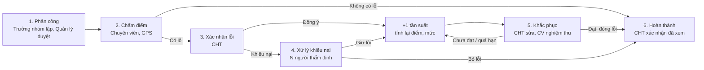

# Đặc tả nghiệp vụ – Phần mềm Kiểm soát Vận hành (KSVH)

> Nguồn: [PM_KIEMSOATVANHANH_CHECK.pdf](PM_KIEMSOATVANHANH_CHECK.pdf) – Ban Giải pháp, 21/10/2026 (18 slide).
> Ký hiệu: **[PDF s.N]** = nội dung có trong slide N; **[ĐỀ XUẤT]** = suy luận kỹ thuật, cần duyệt; **[MỞ Qn]** = chưa rõ, xem §8.
> Số liệu trong PDF (số ngày, khoảng điểm, ngưỡng) là **ví dụ** – phải lưu ở danh mục cấu hình, không viết cứng trong code.

---

## 1. Mục đích & phạm vi
Giúp Phòng KSVH kiểm tra nhà hàng nhanh, chính xác, minh bạch và **theo dõi từng lỗi đến khi khắc phục xong** [PDF s.4].

Đây **không** phải mô hình "chấm checklist → cộng tổng điểm". Mỗi tiêu chí cho kết quả Đạt / Không đạt / N/A. Lỗi được đo bằng **điểm rủi ro = mức ảnh hưởng × tần suất lỗi** [PDF s.14].

Quy mô: 6 nhóm chức năng, 8 vai trò, 70 tiêu chí rủi ro mỗi kỳ, 5 bước xử lý phiếu chấm [PDF s.3].

| # | Nhóm chức năng | Mô tả [PDF s.4] |
|---|---|---|
| 01 | Danh mục | Khai báo nhà hàng, người dùng, tiêu chí dùng chung |
| 02 | Kế hoạch kiểm tra | Lên lịch, giao việc cho Chuyên viên |
| 03 | Chấm điểm | Chấm tại nhà hàng trên điện thoại, chụp ảnh bằng chứng |
| 04 | Xác nhận & khiếu nại | CHT đồng ý lỗi hoặc khiếu nại |
| 05 | Khắc phục lỗi | Theo dõi sửa lỗi đúng hạn và kiểm tra lại |
| 06 | Thông báo, phân quyền | Nhắc việc đúng người; mỗi người chỉ thấy phần việc của mình |

---

## 2. Vai trò [PDF s.6]

| # | Vai trò | Đơn vị | Việc chính | Mã role [ĐỀ XUẤT] |
|---|---|---|---|---|
| 1 | Quản trị hệ thống | Ban Giải pháp | Tạo tài khoản, phân quyền, cấu hình, xem nhật ký | `SYSTEM_ADMIN` |
| 2 | Quản trị nghiệp vụ | Phòng KSVH | Cập nhật tiêu chí, mẫu phiếu, mức rủi ro | `BUSINESS_ADMIN` |
| 3 | Trưởng nhóm KSVH | Phòng KSVH | Lập kế hoạch kiểm tra, phân công Chuyên viên | `KSVH_LEAD` |
| 4 | Quản lý KSVH | Phòng KSVH | Duyệt phân công, xem xét khiếu nại, chủ trì họp thống nhất | `KSVH_MANAGER` |
| 5 | Chuyên viên KSVH | Phòng KSVH | Chấm tiêu chí tại nhà hàng, nghiệm thu khắc phục | `KSVH_INSPECTOR` |
| 6 | Cửa hàng trưởng (CHT) | Nhà hàng | Xác nhận/khiếu nại lỗi; lập và thực hiện khắc phục | `STORE_MANAGER` |
| 7 | OBM | Vận hành | Tham gia xem xét khiếu nại | `OBM` |
| 8 | Ban Giám đốc | Ban Giám đốc | Xem kết quả kiểm tra; **không sửa dữ liệu** | `EXECUTIVE` |

### 2.1 Permission (đã áp dụng – migration `V20261112_1130__ksvh_roles_and_permissions.sql`, `V20261112_1500__user_admin_and_employees.sql`)
Dạng `module:action[:scope]`, khai báo trong `PermissionCodes` + `enum Permission`, gán cho role bằng Flyway. Test `RolePermissionCatalogTests` bắt buộc code và DB khớp nhau.

| Permission | Ý nghĩa | SYS | BIZ | LEAD | MGR | INSP | CHT | OBM | BGĐ |
|---|---|:-:|:-:|:-:|:-:|:-:|:-:|:-:|:-:|
| `user:read` | xem người dùng | ✓ | | ✓ | ✓ | | | | |
| `user:manage`, `role:manage` | tạo tài khoản, phân quyền | ✓ | | | | | | | |
| `system:config`, `system:log:read` | cấu hình, nhật ký hệ thống | ✓ | | | | | | | |
| `employee:read` | xem hồ sơ nhân viên | ✓ | | ✓ | ✓ | | | | |
| `employee:manage` | tạo, sửa nhân viên; liên kết tài khoản | ✓ | | | | | | | |
| `organization:read` | xem công ty, nhà hàng | ✓ | ✓ | ✓ | ✓ | ✓ | | | ✓ |
| `organization:manage` | khai báo công ty, nhà hàng | ✓ | | | | | | | |
| `criteria:read` | xem tiêu chí, mẫu phiếu, cấu hình rủi ro | ✓ | ✓ | ✓ | ✓ | ✓ | | | ✓ |
| `criteria:manage` | sửa danh mục 5–9 | | ✓ | | | | | | |
| `plan:read` | xem kế hoạch | | | ✓ | ✓ | | | | |
| `plan:create` | lập, sửa, gửi duyệt kế hoạch | | | ✓ | | | | | |
| `plan:approve` | duyệt / từ chối kế hoạch | | | | ✓ | | | | |
| `inspection:read:all` | xem mọi phiếu | | ✓ | ✓ | ✓ | | | | ✓ |
| `inspection:read:own` | xem phiếu liên quan (được giao / nhà hàng phụ trách) | | | | | ✓ | ✓ | ✓ | |
| `inspection:perform` | check-in GPS, chấm phiếu được giao | | | | | ✓ | | | |
| `inspection:cancel` | huỷ phiếu (để lập phiếu mới) | | | | ✓ | | | | |
| `finding:respond` | xác nhận / khiếu nại lỗi | | | | | | ✓ | | |
| `finding:review-appeal` | thẩm định khiếu nại được chọn | | | | ✓ | ✓ | | ✓ | |
| `finding:conclude-appeal` | chốt kết luận sau họp | | | | ✓ | | | | |
| `finding:remediate` | lập kế hoạch khắc phục, gửi bằng chứng | | | | | | ✓ | | |
| `finding:verify` | nghiệm thu khắc phục | | | | | ✓ | | | |
| `report:read` | xem dashboard, báo cáo | | ✓ | ✓ | ✓ | | | | ✓ |
| `report:export` | xuất Excel / PDF | | | ✓ | ✓ | | | | ✓ |
| `media:upload` | tải ảnh / video bằng chứng | | | | | ✓ | ✓ | | |

Ghi chú:
- Quản trị trên giao diện (`/admin`, nhóm "Quản trị hệ thống"): xem danh mục permission (chỉ xem – permission định nghĩa trong code), tạo vai trò mới và sửa quyền của vai trò (8 vai trò gốc không xoá / đổi mã; SYSTEM_ADMIN luôn giữ `user:manage`, `role:manage`), quản lý tài khoản, hồ sơ nhân viên. Bảng trên là cấu hình ban đầu.
- Ban Giải pháp nhập dữ liệu tiêu chí ban đầu: gán **thêm** role BUSINESS_ADMIN tạm thời (một user nhiều role), không mở `criteria:manage` cho SYSTEM_ADMIN.
- Chưa chắc chắn, cần xác nhận khi trả lời Q6: Trưởng nhóm có tham gia thẩm định không; ai được huỷ phiếu (hiện chỉ Quản lý); CHT chọn người thẩm định cần quyền xem danh sách nào.
- Giao diện: có quyền dashboard (`user:read`, `organization:manage`, `criteria:manage`, `plan:read`, `inspection:read:all`, `report:read`) → `/admin`; còn lại → `/qc` (`frontend/src/permissions/areas.ts`).

Phạm vi dữ liệu ("mỗi người chỉ thấy phần việc của mình" [PDF s.4]) kiểm tra trong service: Chuyên viên → phiếu được giao; CHT/OBM → nhà hàng mình phụ trách; người thẩm định → khiếu nại được chọn.

---

## 3. Danh mục cần khai báo [PDF s.8]

| # | Danh mục | Người khai báo | Trường chính |
|---|---|---|---|
| 1 | Công ty | Ban Giải pháp | mã, tên |
| 2 | Nhà hàng / phòng ban | Ban Giải pháp | mã, tên, công ty, **CHT phụ trách, OBM phụ trách, vĩ độ, kinh độ, bán kính GPS (m)**, loại nhà hàng [ĐỀ XUẤT, cần cho mẫu phiếu] |
| 3 | Chức danh và phân quyền | Ban Giải pháp | chức danh → tập quyền |
| 4 | Người dùng | Ban Giải pháp | tài khoản, chức danh, nhà hàng / phòng ban |
| 5 | Nhóm tiêu chí & tiêu chí | Phòng KSVH | nhóm, mã, tên, **cách kiểm tra, bằng chứng yêu cầu, mức ảnh hưởng gốc** (70 tiêu chí) |
| 6 | Mẫu phiếu chấm | Phòng KSVH | bộ tiêu chí theo **loại nhà hàng / loại kiểm tra** |
| 7 | Phân loại rủi ro | Phòng KSVH | mức M1–M4, khoảng điểm, **hạn khắc phục (ngày)**, hành động |
| 8 | Cấu hình tần suất | Phòng KSVH | kỳ đếm **1–24 tháng** (PDF gợi ý 3 hoặc 6), **ngày hiệu lực** |
| 9 | Quy tắc nâng mức ảnh hưởng | Phòng KSVH | ngưỡng số lần lỗi, số bậc tăng, mức trần, kỳ hạ lại |

- Ban Giải pháp nhập dữ liệu ban đầu **từ Excel**; sau vận hành Phòng KSVH tự cập nhật danh mục 5–9 [PDF s.8] → cần chức năng import Excel.
- **[ĐỀ XUẤT]** Danh mục 6–9 có **phiên bản / ngày hiệu lực**. Phiếu đã chấm lưu bản sao (snapshot) tiêu chí và mức ảnh hưởng tại thời điểm chấm, để sửa danh mục không làm đổi kết quả cũ.

---

## 4. Quy trình xử lý phiếu chấm [PDF s.7]



### Bước 1 – Phân công & phê duyệt [PDF s.9]
1. Trưởng nhóm lập kế hoạch kiểm tra, gửi phê duyệt.
2. Quản lý KSVH **duyệt** → phần mềm tạo phiếu chấm, thông báo Chuyên viên. Hoặc **từ chối, bắt buộc ghi lý do** → Trưởng nhóm điều chỉnh, gửi lại.
3. Chuyên viên **không được từ chối** phiếu được giao. Đổi người thực hiện = người có quyền **huỷ phiếu và lập phiếu mới** (không sửa người được giao trên phiếu cũ).
- **Đã làm (17/11/2026):**
  - Kế hoạch chứa danh sách phân công (`inspection_plan_assignments`): nhà hàng × chuyên viên × mẫu phiếu × ngày dự kiến. Mỗi nhà hàng tối đa 1 dòng/kế hoạch.
  - Quản lý duyệt kế hoạch (`POST /inspection-plans/{id}/approve`) → server tự sinh phiếu định kỳ cho từng dòng (`InspectionStatus.ASSIGNED`, mã `PER-<yyMM>-<mã NH>-<stt>`, đủ tiêu chí của mẫu). Lỗi bất kỳ dòng nào sẽ rollback toàn bộ đợt duyệt.
  - Chặn tạo phiếu định kỳ (`PERIODIC`) mà không gắn với kế hoạch đã duyệt (áp dụng cho cả tạo đơn và tạo hàng loạt).
  - Đã có module Thông báo trong ứng dụng (Plan 2): thông báo ngay cho Chuyên viên khi kế hoạch được duyệt và tự sinh phiếu.

### Bước 2 – Chấm tại nhà hàng [PDF s.10]
1. Bấm **Bắt đầu** → kiểm tra GPS: khoảng cách tới toạ độ nhà hàng ≤ bán kính. Server tự tính bằng `GeoUtils.distanceMeters`.
2. Đánh giá từng tiêu chí:
   - **Đạt** – ghi nhận.
   - **N/A** – trung lập, chưa đủ cơ sở kết luận (ngoại cảnh, thiết bị cũ…); **bắt buộc ghi lý do**.
   - **Không đạt** – **bắt buộc mô tả lỗi + ít nhất 1 ảnh/video**.
   - **Đã làm (17/11/2026):** ảnh bằng chứng (chấm, khiếu nại, khắc phục) chỉ nhận object key do server cấp qua presign-upload, của chính người gửi, và server kiểm tra object tồn tại trên kho (HEAD); link ngoài bị từ chối (`EVIDENCE_INVALID`).
3. Hoàn tất → gửi kết quả → sang bước 3.

### Bước 3 – CHT xác nhận [PDF s.11]
- Phần mềm thông báo CHT. CHT xem **từng lỗi** và bằng chứng. **Mỗi lỗi xử lý độc lập**.
- **Xác nhận** → ghi nhận lỗi, **tần suất +1** → lập kế hoạch khắc phục (bước 5).
- **Khiếu nại** → giải trình, bằng chứng, **chọn người xét** → bước 4.
- Phiếu không có lỗi: CHT chỉ cần **xác nhận đã xem** → phiếu hoàn thành.
- **Đã làm (17/11/2026):** phiếu không lỗi sau khi gửi ở `AWAITING_ACK`; CHT của nhà hàng gọi `POST /inspections/{id}/acknowledge` → `COMPLETED`, lưu `acknowledged_by/at`. Màn `/qc` của CHT có mục "Phiếu chờ bạn xác nhận đã xem". Điểm tuân thủ trên dashboard tính cả phiếu `AWAITING_ACK`.

### Bước 4 – Xử lý khiếu nại [PDF s.12]
1. CHT gửi khiếu nại, chọn **N người thẩm định**; danh sách **bắt buộc có 1 đại diện KSVH**.
2. Mỗi người đánh giá lại: lỗi đúng hay sai.
3. Tất cả thống nhất → chốt kết luận. Không thống nhất → **họp để thống nhất** (Quản lý KSVH chủ trì [PDF s.6]) → chốt.
4. Kết luận:
   - **Khiếu nại đúng → bỏ lỗi**: lỗi bị loại, **không cộng tần suất, không phải khắc phục**.
     - **Đã làm (17/11/2026):** Giữ nguyên kết quả chấm gốc của Chuyên viên (`FAIL` là bất biến, tuân thủ Quy tắc số 4 – dữ liệu lịch sử không bị sửa). Đổi trạng thái finding thành `DISMISSED`. Tiêu chí có lỗi `DISMISSED` được tính tương đương đạt khi tính `adjustedComplianceScore` (Điểm tuân thủ sau khiếu nại) phục vụ dashboard và báo cáo. Giao diện chi tiết phiếu hiển thị tag "Không đạt – lỗi đã bỏ do khiếu nại".
   - **Khiếu nại sai → giữ lỗi**: lỗi giữ nguyên, **tần suất +1**, phải khắc phục.
     - **Đã làm (17/11/2026):** Khi giữ lỗi sau khiếu nại (`UPHELD`), hạn khắc phục được tính lại từ ngày chốt (`hôm nay + số ngày khắc phục theo mức rủi ro`) để nhà hàng có đủ thời gian khắc phục và tránh bị job quá hạn phạt +1 oan. Ghi chú vào lịch sử xử lý lỗi và quy định: **(chờ KSVH xác nhận)**.
   - **[ĐỀ XUẤT]** "Lỗi bị xoá" = đổi trạng thái DISMISSED, **không xoá dòng** (giữ lịch sử).

### Bước 5 – Khắc phục & nghiệm thu [PDF s.13]
1. CHT lập kế hoạch khắc phục kèm ngày hẹn. **Ngày hẹn ≤ hạn khắc phục của mức rủi ro** (vd M3 = 7 ngày).
2. CHT khắc phục, gửi ảnh bằng chứng.
3. Chuyên viên nghiệm thu:
   - **Đạt** → đóng lỗi. Mọi lỗi của phiếu đã đóng (hoặc bị bỏ) → **phiếu hoàn thành**.
   - **Chưa đạt** → phần mềm **tự +1 tần suất**, mở vòng mới, CHT lập lại kế hoạch.
4. **Quá hạn** mà chưa nghiệm thu đạt → phần mềm **tự +1 tần suất** [PDF s.7, s.13] → cần job định kỳ.
   - **Đã làm (17/11/2026):** `FindingOverdueJob` chạy 00:05 hằng ngày (giờ VN): lỗi `CONFIRMED` / `REMEDIATING` / `PENDING_VERIFICATION` có hạn < hôm nay → ghi `finding_occurrence` nguồn `OVERDUE`, tính lại điểm/mức, **hạn mới = hôm nay + số ngày của mức mới**, về `CONFIRMED` (vòng mới), lịch sử action `OVERDUE` (người thực hiện = hệ thống). Hạn mới ở tương lai nên mỗi vòng chỉ +1 một lần. Lưu ý: tính cả lỗi đang chờ nghiệm thu (theo §5.3) – nếu Chuyên viên nghiệm thu chậm thì nhà hàng vẫn bị +1; cần Phòng KSVH xác nhận.

---

### Bổ sung theo tài liệu Word "Ví dụ quy trình kiểm tra ... YS-LTT" (chốt với người dùng 16/11/2026)
| Loại kiểm tra | Điều kiện | Phạm vi | Hình thức |
|---|---|---|---|
| Định kỳ tháng (`PERIODIC`) | Theo kế hoạch tháng đã duyệt | Đủ mọi tiêu chí của mẫu phiếu (vd 70 điểm), không ngoại lệ | Thực tế tại nhà hàng |
| Đột xuất (`SURPRISE`) | Rủi ro cao / dấu hiệu bất thường | Chỉ **chuyên đề** được kích hoạt = các **nhóm tiêu chí** được chọn | Thực tế hoặc từ xa |
| Kiểm tra kết quả khắc phục (`VERIFICATION`) | Sau khi nhà hàng gửi bằng chứng / lỗi chờ nghiệm thu | Các lỗi cần xác minh | Thực tế hoặc từ xa — **Đã làm (17/11/2026)**: gom các lỗi của nhà hàng vào 1 phiếu; chỉ nhận lỗi `PENDING_VERIFICATION` (đã gửi bằng chứng khắc phục, chờ KSVH xác nhận); kết quả Đạt đóng lỗi `CLOSED`, Chưa đạt phạt +1 `CONFIRMED` mở chu kỳ mới |

- **Bỏ "loại nhà hàng"**; mẫu phiếu chỉ còn giới hạn theo công ty.
- **GPS chưa bắt buộc:** nhà hàng không bắt buộc khai toạ độ; khi bắt đầu kiểm tra hệ thống chỉ **ghi nhận** vị trí (`VERIFIED` / `OUTSIDE_RADIUS` / `UNVERIFIED` / `REMOTE`), không chặn.
- **Điểm tuân thủ** (NT03) = tổng trọng số tiêu chí Đạt / tổng trọng số Đạt + Không đạt × 100, N/A không tính; trọng số = mức ảnh hưởng gốc 1–5. Khác và không thay thế điểm rủi ro.
- **Công thức rủi ro giữ theo PDF** (§6); các số trong Word (ngưỡng 1/6/12/20, hạ mức sau 2 kỳ, hệ số tái phạm 1,0–2,0, Phó/Trưởng phòng phê duyệt mức rủi ro) chỉ là minh hoạ — chưa áp dụng.
- **Đã làm Plan 5 (17/11/2026):**
  - **Phiếu kiểm tra kết quả khắc phục (`VERIFICATION`):** Gom các lỗi chờ nghiệm thu của nhà hàng vào một phiếu kiểm tra (thực tế hoặc từ xa). **Quy định (chờ KSVH xác nhận):** Chỉ nhận lỗi ở trạng thái `PENDING_VERIFICATION` (nhà hàng đã gửi bằng chứng), từ chối lỗi `REMEDIATING` (chưa gửi bằng chứng). Chuyên viên chấm: Đạt (`PASS` → `CLOSED`), Chưa đạt (`FAIL` → `CONFIRMED` +1 vi phạm mở vòng mới).
  - **Đề xuất kiểm tra đột xuất (`SurpriseInspectionSuggestion`):** Hệ thống tự động phân tích điểm rủi ro, phát hiện nhà hàng có lỗi M4/M3 chưa khắc phục hoặc tiêu chí bị nâng mức, gợi ý các chuyên đề vi phạm cần kiểm tra. Nút "Gợi ý đột xuất" kèm Badge trên trang Danh sách phiếu kiểm tra cho phép 1 chạm tạo phiếu.
  - **Cảnh báo kế hoạch (`PriorFindingsWarning`):** Tự động phát hiện nhà hàng còn lỗi vi phạm chưa nghiệm thu từ tháng trước. Cảnh báo trực quan hiển thị trong chi tiết kế hoạch và form phân công khi lập kế hoạch tháng.
- Chưa làm (theo Word): xử lý giải trình nhiều cấp (cấp vận hành → OBM/Phó/Trưởng phòng → BGĐ, có "yêu cầu bổ sung"), kế hoạch khắc phục chi tiết (nguyên nhân gốc, biện pháp, người phụ trách), trạng thái "mở lại".

## 5. Máy trạng thái [ĐỀ XUẤT]

### 5.1 Kế hoạch kiểm tra (`inspection_plan`)
```
DRAFT → PENDING_APPROVAL → APPROVED
               │
               └→ REJECTED (lý do) → (sửa) → PENDING_APPROVAL
```

### 5.2 Phiếu chấm (`inspection`)
```
ASSIGNED → IN_PROGRESS (Bắt đầu + GPS hợp lệ) → SUBMITTED
SUBMITTED ── không lỗi ──→ AWAITING_ACK → COMPLETED (CHT đã xem)
SUBMITTED ── có lỗi ─────→ AWAITING_RESPONSE → IN_RESOLUTION → COMPLETED
ASSIGNED / IN_PROGRESS → CANCELLED (người có quyền huỷ, ghi lý do)
```
- `IN_RESOLUTION`: còn ít nhất 1 lỗi đang khiếu nại hoặc khắc phục.
- `COMPLETED`: mọi lỗi CLOSED hoặc DISMISSED.
- Từ `SUBMITTED` trở đi, kết quả chấm **bất biến** với Chuyên viên (CLAUDE.md quy tắc 4).

### 5.3 Lỗi (`finding`) – mỗi tiêu chí Không đạt sinh 1 lỗi
```
OPEN ──(CHT xác nhận)────────────────→ CONFIRMED (+1)
OPEN ──(CHT khiếu nại, N=2..5 thẩm định)─→ APPEALED
APPEALED ──(100% đồng thuận giữ lỗi)──→ CONFIRMED (+1)
APPEALED ──(100% đồng thuận bỏ lỗi)───→ DISMISSED (kết thúc, tiêu chí đổi sang PASS)
APPEALED ──(bất đồng ý kiến)──────────→ APPEAL_MEETING
APPEAL_MEETING ──(Quản lý KSVH chốt giữ)─→ CONFIRMED (+1, ghi biên bản họp)
APPEAL_MEETING ──(Quản lý KSVH chốt bỏ)──→ DISMISSED (kết thúc, tiêu chí đổi sang PASS, ghi biên bản họp)
CONFIRMED ──(CHT lập kế hoạch)───────→ REMEDIATING
REMEDIATING ──(CHT gửi bằng chứng)───→ PENDING_VERIFICATION
PENDING_VERIFICATION ──(CV: đạt)─────→ CLOSED             (kết thúc)
PENDING_VERIFICATION ──(CV: chưa đạt)→ CONFIRMED (+1, vòng mới)
REMEDIATING/PENDING_VERIFICATION ──(quá hạn, job)→ CONFIRMED (+1, vòng mới)
```
Mỗi "+1" ghi một dòng `finding_occurrence` (nhà hàng, tiêu chí, thời điểm, nguồn: CONFIRMED / APPEAL_UPHELD / VERIFY_FAILED / OVERDUE). Tần suất **đếm từ bảng này**, không lưu dạng số cộng dồn.

**Đã làm Plan 1 (17/11/2026):**
- Hội đồng thẩm định khiếu nại $N \in [2, 5]$ người do CHT chọn từ danh sách ứng viên (`GET /candidate-reviewers`: user active có vai trò KSVH_INSPECTOR, KSVH_LEAD, KSVH_MANAGER hoặc OBM quản lý nhà hàng; loại trừ chuyên viên đã chấm lỗi). Bắt buộc có $\ge 1$ đại diện KSVH.
- Mỗi người gửi ý kiến độc lập (`POST /findings/{id}/appeal-reviews` với `FINDING_VALID` / `FINDING_INVALID` kèm nhận xét).
- Hệ thống tự động chốt khi tất cả đã thẩm định: 100% đồng thuận `FINDING_INVALID` → `DISMISSED` (huỷ lỗi, không +1, cập nhật kết quả tiêu chí trên phiếu thành `PASS`); 100% đồng thuận `FINDING_VALID` → `CONFIRMED` (+1); bất đồng ý kiến → `APPEAL_MEETING`.
- Ở trạng thái `APPEAL_MEETING`, Quản lý KSVH chủ trì họp thống nhất và kết luận (`POST /findings/{id}/conclude-appeal` kèm `meetingNotes`).
- API danh sách việc cần làm: `GET /findings/pending-reviews`. Giao diện web và mobile hỗ trợ xem hội đồng thẩm định, gửi ý kiến đánh giá, tab "Chờ tôi thẩm định".


---

## 6. Quy tắc tính rủi ro [PDF s.14–16]

### 6.1 Công thức
```
Điểm rủi ro = Mức ảnh hưởng (hiệu lực) × Tần suất lỗi
```
Tính theo cặp **(nhà hàng, tiêu chí)**.

### 6.2 Mức rủi ro (ví dụ – lấy từ danh mục 7)
| Mức | Tên | Khoảng điểm (PDF) | Hạn khắc phục | Hành động |
|---|---|---|---|---|
| M1 | Thấp | 0 – 1 | 60 ngày | Theo dõi và chuẩn hoá |
| M2 | Trung bình | 1 – 6 | 30 ngày | Khắc phục có kế hoạch |
| M3 | Cao | 6 – 12 | 7 ngày | Khắc phục, phòng ngừa, kiểm tra lại |
| M4 | Nghiêm trọng | 12 – 20 | 1 ngày | Lập biên bản, báo cáo lãnh đạo |

**Đã chốt 12/11/2026:** khoảng `[min, max)` (điểm 1 → M2, điểm 6 → M3 như ví dụ s.16), mức cao nhất `[12, +∞)`. Thang mức ảnh hưởng **1–5**, mức trần nâng mức là giá trị cấu hình (mặc định 5).

**Đã làm (12/11/2026):** danh mục 5–9 trên `/admin` nhóm "Danh mục thiết lập" (migration `V20261112_1700__criteria_catalog.sql`). Số liệu M1–M4, kỳ đếm 6 tháng, ngưỡng 3 lần / +1 bậc / trần 5 / hạ lại 6 tháng được nạp sẵn là **ví dụ PDF – chờ Phòng KSVH xác nhận**. Tần suất và nâng mức lưu theo phiên bản ngày hiệu lực (không áp dụng ngược, không sửa bản cũ).

**Đã làm (16/11/2026):** bộ tính thuần `vn.ksvh.qc.risk.RiskCalculator` (unit test TC-1…TC-5) dùng khi gửi phiếu và khi nghiệm thu chưa đạt; đọc kỳ đếm, quy tắc nâng mức, bảng mức **đang hiệu lực tại ngày tính**. Lỗi lưu cả `base_impact` (gốc) và `effective_impact` (sau nâng mức); điểm = effective × tần suất. **Giả định chờ xác nhận Q3:** kỳ đếm và kỳ hạ mức tính theo **tháng dương lịch** (kỳ 6 tháng tại T8 = T3..T8). Q4 đã chốt 17/11/2026: vòng mới tính lại hạn theo mức mới. Mô phỏng trên giao diện gọi `GET /api/v1/risk/preview` (cùng bộ tính).

### 6.3 Đếm tần suất theo kỳ [PDF s.15]
- Cộng **mọi** lần lỗi của cùng tiêu chí, tại cùng nhà hàng, trong **kỳ đếm gần nhất** (số tháng theo cấu hình có ngày hiệu lực; PDF gợi ý 3 hoặc 6).
- **Đã làm (17/11/2026, theo yêu cầu người dùng):** kỳ đếm không còn khoá 3/6 – nhập số tháng bất kỳ **1–24** (DB `ck_frequency_configs_period_months`, `@Min/@Max` ở `FrequencyConfigRequest`, form có gợi ý nhanh 3/6/12). Bộ tính `RiskCalculator` vốn đã hỗ trợ mọi kỳ ≥ 1 tháng.
- Lỗi cũ hơn kỳ đếm tự ra khỏi kỳ. Tháng Đạt xen kẽ **không xoá** các lần lỗi trước trong kỳ.
- Lỗi bị bỏ do khiếu nại đúng: **không tính**.

### 6.4 Nâng mức ảnh hưởng [PDF s.16]
1. **Ngưỡng:** cùng tiêu chí, cùng nhà hàng, lỗi ≥ ngưỡng (vd 3) lần trong kỳ đếm.
2. **Nâng bậc:** mức ảnh hưởng +N bậc (vd +1), tối đa mức trần.
3. **Phạm vi:** chỉ nhà hàng tái phạm (A nâng 1 → 2; B cùng tiêu chí vẫn là 1).
4. **Hạ lại:** đủ 1 kỳ hạ (vd 6 tháng) liên tục không lỗi tiêu chí đó → về mức gốc. Lỗi lại trong thời gian chờ → đếm lại từ lần lỗi mới.

### 6.5 Ví dụ kiểm thử (dùng làm unit test)
**TC-1 – Đếm theo kỳ [PDF s.15]:** kỳ 6 tháng, đang tính tại T8. Lỗi ở T1, T2, T3, T5, T8; Đạt ở T4, T6, T7. → Kỳ = T3..T8, **tần suất = 3**.

**TC-2 – Nâng mức "Bàn ghế bụi" [PDF s.16]:** ảnh hưởng gốc 1, ngưỡng 3, +1 bậc.

| Lần lỗi | Ảnh hưởng | Điểm | Mức kỳ vọng | Nếu không nâng |
|---|---|---|---|---|
| 1 | 1 | 1 | M2 | 1 · M2 |
| 2 | 1 | 2 | M2 | 2 · M2 |
| 3 | 2 ▲ | 6 | M3 (hạn 7 ngày) | 3 · M2 |
| 4 | 2 | 8 | M3 | 4 · M2 |

**TC-3 – Hạ mức [PDF s.16]:** nhà hàng A bị nâng ở T3; T4→T9 không lỗi → **T10 về mức gốc 1**. Biến thể: lỗi lại ở T7 → kỳ 6 tháng đếm lại từ T7.

**TC-4 – Phạm vi:** A bị nâng, B cùng tiêu chí chưa tái phạm → B vẫn dùng ảnh hưởng gốc.

**TC-5 – Khiếu nại đúng:** lỗi DISMISSED → không có `finding_occurrence`, tần suất không đổi.

---

## 7. Hệ quả cho kiến trúc (đã duyệt 12/11/2026)

Khung đang giả định "phiên chấm → tổng điểm → SUBMITTED/APPROVED", role ADMIN/MANAGER/AUDITOR và module `location`, `checklist`, `audit`. Đề xuất đổi sang:

| Module backend | Nội dung | Thay cho |
|---|---|---|
| `auth`, `user` | giữ nguyên; thêm 8 role ở §2 | ADMIN/MANAGER/AUDITOR |
| `organization` | công ty, nhà hàng (toạ độ, bán kính, CHT, OBM, loại) | `location` |
| `criteria` | nhóm tiêu chí, tiêu chí, mẫu phiếu, mức rủi ro, cấu hình tần suất, quy tắc nâng mức | `checklist` |
| `plan` | kế hoạch kiểm tra, phê duyệt | mới |
| `inspection` | phiếu chấm, check-in GPS, kết quả từng tiêu chí | `audit` |
| `finding` | lỗi, khiếu nại & thẩm định, khắc phục & nghiệm thu, job quá hạn | mới |
| `risk` | tính tần suất, điểm, mức, nâng/hạ ảnh hưởng (thuần, dễ test) | mới |
| `notification` | nhắc việc | mới |
| `audit` | nhật ký hệ thống ghi vết thao tác quản trị, phân quyền, huỷ phiếu, đổi cấu hình rủi ro | mới |
| `media`, `report` | giữ nguyên; `media` thêm video | – |

Việc kéo theo: sửa danh sách module trong CLAUDE.md gốc; sửa "tự tính tổng điểm" thành "tự tính tần suất/điểm rủi ro"; quy tắc 4 (bất biến sau SUBMITTED) giữ nguyên ý.

---

## 8. Câu hỏi còn mở (hỏi Phòng KSVH / Ban Giải pháp)

| # | Câu hỏi | Ảnh hưởng tới |
|---|---|---|
| Q1 | ~~Biên khoảng điểm, thang ảnh hưởng~~ – **đã chốt 12/11/2026**: `[min, max)`, thang 1–5, điểm > 20 vẫn là M4. Còn chờ KSVH xác nhận số ngày / khoảng điểm thực tế. | Bảng `risk_levels` |
| Q2 | Một tiêu chí lỗi nhiều lần trong cùng tháng (chấm lại, nghiệm thu chưa đạt, quá hạn) tính mấy lần? Quá hạn **và** nghiệm thu chưa đạt cùng một vòng có +2 không? | `finding_occurrence` |
| Q3 | Kỳ đếm cuốn theo **tháng dương lịch** (T3–T8) hay theo **số ngày** (180 ngày trước)? | Hàm đếm tần suất |
| Q4 | ~~Hạn khắc phục lấy theo mức lúc xác nhận hay tính lại mỗi vòng?~~ – **đã chốt 17/11/2026**: mỗi vòng mới (nghiệm thu chưa đạt / quá hạn) hạn = ngày mở vòng + số ngày khắc phục của **mức sau khi tính lại**. | Hạn của vòng khắc phục |
| Q5 | CHT có hạn phản hồi (xác nhận/khiếu nại) không? Quá hạn có tự coi là xác nhận không? | Job, trạng thái OPEN |
| Q6 | CHT chọn người thẩm định từ danh sách nào? N tối thiểu/tối đa? Ai nhập kết luận cuộc họp? Có hạn xử lý khiếu nại không? (chi tiết + thiết kế: [PLAN_APPEAL_REVIEW_AND_NOTIFICATION.md](PLAN_APPEAL_REVIEW_AND_NOTIFICATION.md)) | Khiếu nại |
| Q7 | "% tuân thủ" và "6/9 tiêu chí" trên dashboard [s.1] tính thế nào? N/A có bị loại khỏi mẫu số không? | Báo cáo |
| Q8 | ~~Một kế hoạch gồm nhiều phiếu (nhiều nhà hàng)? Chu kỳ lập kế hoạch (tháng)? Mã phiếu `PER-2610-NH002-01` có phải `PER-<yyMM>-<mã NH>-<stt>`?~~ – **Đã làm 17/11/2026**: 1 kế hoạch chứa nhiều dòng phân công (mỗi nhà hàng 1 dòng/kế hoạch), duyệt tự sinh phiếu theo mã `PER-<yyMM>-<mã NH>-<stt>`. Phiếu định kỳ bắt buộc thuộc kế hoạch đã duyệt. (Chờ KSVH xác nhận thực tế). | `plan`, `inspection_plan_assignments`, mã phiếu |
| Q9 | Kênh thông báo: trong app, email, Zalo, SMS? (thiết kế: [PLAN_APPEAL_REVIEW_AND_NOTIFICATION.md](PLAN_APPEAL_REVIEW_AND_NOTIFICATION.md)) | `notification` |
| Q10 | Video bằng chứng: giới hạn dung lượng/thời lượng? CHT, OBM dùng giao diện điện thoại hay dashboard? | `media`, frontend |
| Q11 | Chuyên viên có được chấm lại/sửa sau khi gửi không (ví dụ mất mạng giữa chừng)? Có cần chữ ký CHT tại chỗ không? | `inspection` |
| Q12 | Lỗi M4 "lập biên bản, báo cáo lãnh đạo": phần mềm cần sinh biên bản PDF và tự gửi Ban Giám đốc không? | `report`, `notification` |
