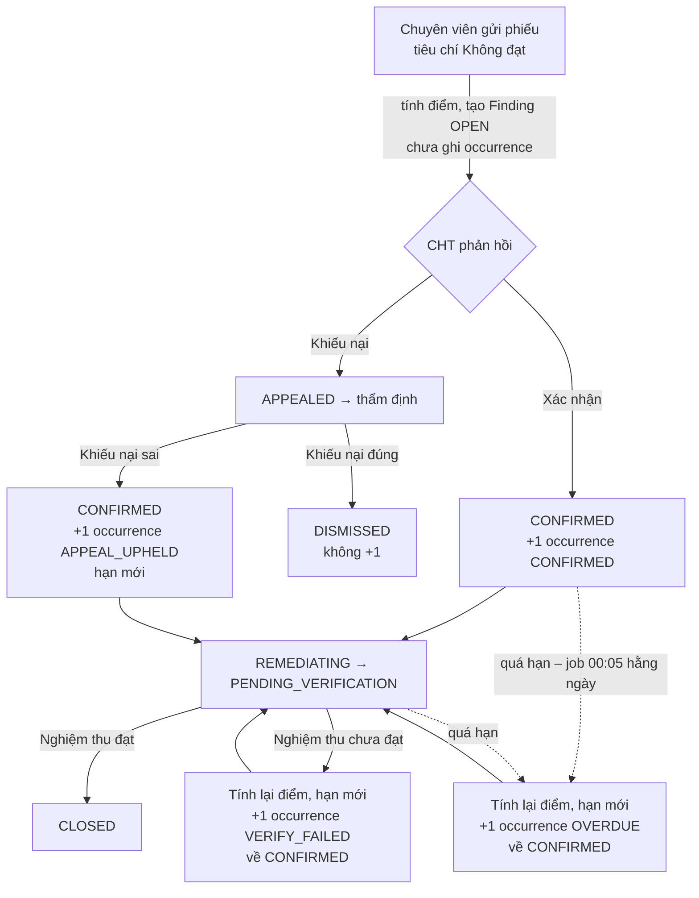

# Điểm rủi ro, tần suất và nâng / hạ mức – tài liệu cho dev

> Đọc kèm [DOMAIN_SPEC.md](DOMAIN_SPEC.md) §6 (nghiệp vụ gốc) và §8 (câu hỏi mở).
> Cập nhật 19/11/2026. Mọi con số mặc định bên dưới là **giá trị ví dụ trong PDF – chờ Phòng KSVH xác nhận**.

## 1. Tóm tắt một dòng

```
Điểm rủi ro = Mức ảnh hưởng hiệu lực × Tần suất
```

- **Tần suất**: số lần *cùng nhà hàng* mắc *cùng tiêu chí* trong **kỳ đếm** (tính cả lần đang xét).
- **Mức ảnh hưởng hiệu lực**: mức ảnh hưởng gốc của tiêu chí (1–5), **được nâng thêm bậc** nếu tái phạm đủ **ngưỡng**.
- Điểm → tra **bảng mức rủi ro** (M1–M4) → ra **số ngày khắc phục** → server đặt **hạn khắc phục**.

Tất cả do **server** tính (quy tắc 1 trong CLAUDE.md). Client chỉ gửi kết quả Đạt / Không đạt / N/A.

## 2. Các khái niệm và nơi cấu hình

| Khái niệm | Ý nghĩa | Khai báo ở đâu | Bảng DB | Mặc định |
|---|---|---|---|---|
| Mức ảnh hưởng gốc | Độ nặng của tiêu chí, 1–5 | Danh mục Tiêu chí | `criteria.base_impact` | – |
| Kỳ đếm tần suất | Lùi bao nhiêu tháng để đếm lỗi | Trang *Quy tắc tái phạm & Nâng mức* (danh mục 8) | `frequency_configs` | 6 tháng |
| Ngưỡng nâng mức | Tái phạm từ lần thứ mấy thì nâng | Cùng trang (danh mục 9) | `impact_escalation_rules.threshold_count` | 3 lần |
| Số bậc nâng | Nâng thêm mấy bậc | Cùng trang | `step_increase` | +1 |
| Mức trần | Nâng tối đa tới mức nào | Cùng trang | `max_impact` | 5 |
| Kỳ hạ mức | Bao nhiêu tháng sạch lỗi thì về mức gốc | Cùng trang | `reset_period_months` | 6 tháng |
| Ngưỡng / kỳ hạ mức **riêng nhà hàng** | Nhà hàng cần khắt khe hơn (fine dining) | Form Nhà hàng (Danh mục cơ sở) | `org_units.escalation_threshold`, `org_units.escalation_reset_months` | trống = theo quy tắc chung |
| Bảng mức rủi ro | Khoảng điểm → M1–M4 + số ngày khắc phục | Trang *Phân loại rủi ro* (danh mục 7) | `risk_levels` | xem §5 |

### Phiên bản theo ngày hiệu lực

`frequency_configs`, `impact_escalation_rules`, `risk_levels` **không sửa bản cũ**, mỗi lần đổi là thêm một phiên bản có `effective_from`.

- Khi tính rủi ro tại ngày `D`, hệ thống lấy phiên bản **có `effective_from` lớn nhất mà ≤ D** (`CriteriaLookupApi.riskConfigAt(D)`).
- Ngày hiệu lực **không phải ngày bắt đầu kỳ đếm**. Nó là ngày *bắt đầu dùng con số mới*. Lỗi trước ngày đó giữ cách tính cũ, không bị tính lại.
- Chỉ được tạo phiên bản có ngày ≥ hôm nay; chỉ được xoá phiên bản chưa tới ngày hiệu lực (`SCHEDULED`).

### Vì sao kỳ đếm không đặt trên mẫu phiếu

- Tần suất đếm theo cặp **(nhà hàng, tiêu chí)**, không phụ thuộc phiếu nào phát hiện lỗi. Lỗi lần trước do phiếu đột xuất, lần này do phiếu định kỳ → vẫn là tái phạm.
- Phiếu **đột xuất không có mẫu** (chọn nhóm tiêu chí làm chuyên đề).
- Một tiêu chí có thể nằm trong nhiều mẫu → nếu mỗi mẫu một kỳ, cùng một lỗi sẽ ra điểm khác nhau.

### Vì sao ngưỡng riêng đặt trên nhà hàng

Nhà hàng fine dining (Tenku `TNK-LM81`, Ussina `USS-LM81`) cần nâng mức sớm hơn. Chỉ ghi đè **ngưỡng** và **kỳ hạ mức**; số bậc nâng và mức trần luôn theo quy tắc chung. Để trống = dùng quy tắc chung.

## 3. Kỳ đếm tính như thế nào

**Giả định chờ xác nhận (Q3): tháng dương lịch**, tính lùi từ ngày phát sinh lỗi, gồm cả tháng hiện tại.

```
periodStart(D) = ngày 1 của tháng D, lùi (kỳ − 1) tháng
```

| Ngày lỗi | Kỳ 6 tháng |
|---|---|
| 20/08/2026 | 01/03/2026 → 20/08/2026 |
| 05/11/2026 | 01/06/2026 → 05/11/2026 |
| 10/01/2027 | 01/08/2026 → 10/01/2027 |

Kỳ đếm **trượt theo từng lần lỗi**, không có ngày bắt đầu cố định. Lỗi rơi ra ngoài kỳ thì không còn được đếm.

Đổi sang "180 ngày" (nếu KSVH chốt khác) chỉ cần sửa `RiskCalculator.periodStart` và `cleanMonthsBetween`.

## 4. Nâng mức và hạ mức

Duyệt các lần lỗi theo thời gian (`RiskCalculator.assess`):

1. Với mỗi lần lỗi `d`, đếm số lần lỗi trong kỳ chứa `d`.
2. Nếu số lần ≥ **ngưỡng** → đánh dấu *đang nâng mức*. Trạng thái này **dính lại** (sticky) cho các lần sau.
3. Nếu đang nâng mức mà giữa lần lỗi trước và lần này có **≥ kỳ hạ mức** tháng trọn vẹn không lỗi → **hạ về mức gốc**, và **đếm tần suất lại từ đầu** tính từ lần lỗi này (lỗi cũ trước mốc hạ mức không đếm nữa).
4. Mức hiệu lực = `min(gốc + số bậc nâng, mức trần)` nếu đang nâng, ngược lại = gốc.

"Tháng sạch lỗi" là tháng dương lịch trọn vẹn nằm **giữa** tháng của hai lần lỗi (không tính hai đầu).

## 5. Bảng mức rủi ro (mặc định)

Khoảng điểm là **[min, max)**: điểm 6 thuộc M3, không thuộc M2.

| Mức | Tên | Điểm | Số ngày khắc phục |
|---|---|---|---|
| M1 | Thấp | [0, 1) | 60 |
| M2 | Trung bình | [1, 6) | 30 |
| M3 | Cao | [6, 12) | 7 |
| M4 | Nghiêm trọng | ≥ 12 | 1 |

Điểm nhỏ nhất của một lỗi là 1 × 1 = 1, nên với bảng mặc định lỗi thực tế bắt đầu từ M2.
Không tìm thấy mức cho điểm → báo lỗi `RISK_LEVEL_NOT_CONFIGURED` (không tự bịa mức).

## 6. Ví dụ đầy đủ

Tiêu chí *"Nhiệt độ tủ mát"*, mức gốc **2**. Quy tắc chung: kỳ 6 tháng, ngưỡng 3, +1 bậc, trần 5, hạ sau 6 tháng.

### Nhà hàng theo quy tắc chung

| Ngày lỗi | Kỳ đếm | Tần suất | Ảnh hưởng | Điểm | Mức | Hạn khắc phục |
|---|---|---|---|---|---|---|
| 10/03 | T10 năm trước → T3 | 1 | 2 | 2 | M2 | +30 ngày |
| 15/05 | T12 → T5 | 2 | 2 | 4 | M2 | +30 ngày |
| 20/08 | T3 → T8 | **3** (đủ ngưỡng) | **3** | 9 | **M3** | +7 ngày |
| 12/10 | T5 → T10 | 3 (T3 rơi ra) | 3 (vẫn nâng – sticky) | 9 | M3 | +7 ngày |

Nếu sau 12/10 không mắc lại suốt T11 → T4 (6 tháng sạch), lần mắc tiếp theo từ T5 sẽ về mức gốc 2 và tần suất đếm lại từ 1.

### Nhà hàng có ngưỡng riêng 2 lần (fine dining)

| Ngày lỗi | Tần suất | Ảnh hưởng | Điểm | Mức |
|---|---|---|---|---|
| 10/03 | 1 | 2 | 2 | M2 |
| 15/05 | **2** (đủ ngưỡng riêng) | **3** | 6 | **M3** |

## 7. Luồng trong hệ thống – khi nào tính, khi nào +1 tần suất

Tần suất **không lưu số cộng dồn**. Mỗi lần lỗi "chính thức" là một dòng trong `finding_occurrences` (`restaurant_id`, `criterion_id`, `finding_id`, `source`, `occurred_at`). Tần suất luôn đếm lại từ bảng này (quy tắc 4).



| Sự kiện | Code | Tính lại điểm? | Ghi occurrence | Hạn khắc phục |
|---|---|---|---|---|
| Gửi phiếu, tiêu chí FAIL | `InspectionExecutionService.submit` | Có – lịch sử + lần này | Chưa | hôm nay + số ngày của mức |
| CHT xác nhận | `FindingResponseService.confirm` | Không | `CONFIRMED` | giữ nguyên |
| Khiếu nại sai (giữ lỗi) | `FindingResponseService` (thẩm định / họp) | Không | `APPEAL_UPHELD` | hôm nay + số ngày |
| Khiếu nại đúng (bỏ lỗi) | như trên | – | Không – lỗi chỉ đổi trạng thái `DISMISSED`, không xoá | – |
| Nghiệm thu chưa đạt | `FindingRemediationService.verifyInternal` | Có | `VERIFY_FAILED` | hôm nay + số ngày của mức mới |
| Quá hạn (job hằng ngày) | `FindingRemediationService.markOverdueFindings` | Có | `OVERDUE` | hôm nay + số ngày của mức mới |

Lưu ý:

- Lúc gửi phiếu, lần lỗi đang xét **được tính vào tần suất** dù chưa có dòng occurrence. Dòng occurrence chỉ ghi khi lỗi được xác nhận / giữ lại, nên lỗi bị bỏ không làm tăng tần suất về sau.
- Mỗi lần chuyển trạng thái ghi `finding_events` (người, thời điểm, ghi chú) – quy tắc 4.
- Lỗi mức M4 bắn `FindingM4AlertEvent` để nhắc việc.

## 8. Bản đồ code

| Việc | File |
|---|---|
| Công thức thuần (kỳ đếm, nâng / hạ mức, tra mức) | `backend/.../risk/RiskCalculator.java` |
| Gói quy tắc + ghi đè ngưỡng riêng | `risk/RiskRules.java` (`from`, `withEscalationOverride`) |
| **Chỗ duy nhất** chọn quy tắc cho một nhà hàng | `inspection/service/RiskAssessor.java` (`rulesFor`, `assessNew`) |
| Tra cấu hình hiệu lực theo ngày | `criteria/service/CriteriaLookupService.riskConfigAt` |
| Gửi phiếu → tạo lỗi | `inspection/service/InspectionExecutionService.java` |
| Xác nhận / khiếu nại | `inspection/service/finding/FindingResponseService.java` |
| Khắc phục / nghiệm thu / quá hạn | `inspection/service/finding/FindingRemediationService.java`, `FindingOverdueJob.java` |
| Hồ sơ rủi ro nhà hàng, tiêu chí đang bị nâng mức | `inspection/service/RestaurantRiskProfileService.java` |
| Mô phỏng trên giao diện | `GET /api/v1/risk/preview?baseImpact=&violations=&date=` (`risk/web/RiskPreviewController.java`) – dùng cùng bộ tính, giao diện không tự tính |
| Test | `RiskCalculatorTests` (TC-1…TC-5), `RiskRulesTests` (ngưỡng riêng), `RiskPreviewApiTests`, `RestaurantRiskProfileApiTests` |

Quy ước khi sửa:

- **Không** tự tính rủi ro ở chỗ khác – luôn đi qua `RiskAssessor.rulesFor(...)` để ngưỡng riêng nhà hàng được áp dụng đồng nhất.
- Đổi công thức → sửa `RiskCalculator` + thêm test trong `RiskCalculatorTests`.
- Đổi schema → migration Flyway mới (`V<yyyyMMdd_HHmm>__...sql`), không sửa migration đã chạy.

## 9. Còn chờ Phòng KSVH chốt

- **Q3**: kỳ đếm theo tháng dương lịch (đang làm) hay 180 ngày?
- Các con số mặc định: kỳ 6 tháng, ngưỡng 3, +1 bậc, trần 5, hạ sau 6 tháng; ngưỡng riêng 2 lần cho Tenku / Ussina.
- Lỗi đang **chờ nghiệm thu** (CHT đã báo khắc phục xong) mà quá hạn có bị +1 tần suất không? Hiện job quá hạn **có** tính cả trạng thái `PENDING_VERIFICATION`.
- Xác nhận lỗi (`CONFIRMED`) hiện **không** tính lại điểm – điểm giữ như lúc gửi phiếu. Đúng ý nghiệp vụ chưa?
